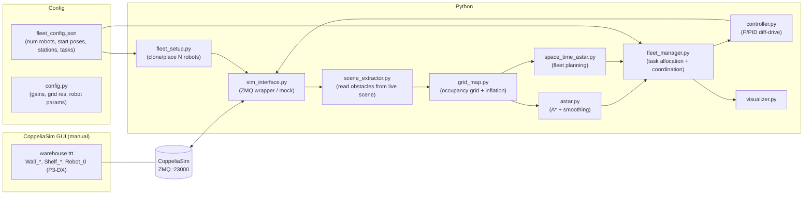
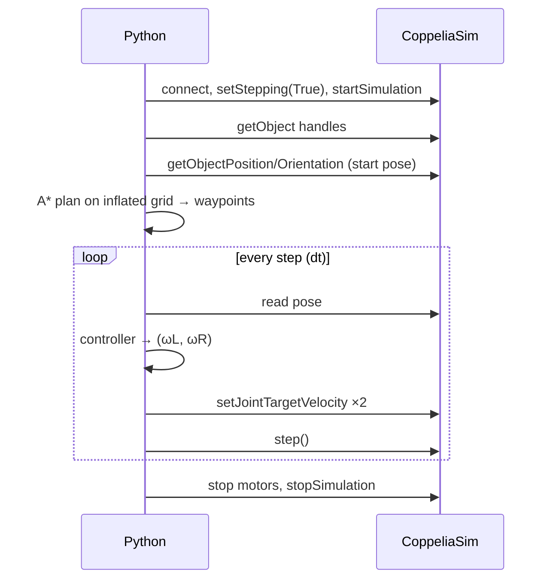

# Warehouse Mobile Robot Fleet with A* Path Planning — Implementation Plan

**Stack:** CoppeliaSim (≥ 4.6) · Pioneer P3-DX · Python 3.9+ · ZeroMQ Remote API (`coppeliasim-zmqremoteapi-client`) · NumPy

> [!NOTE]
> Per your instruction, nothing will be executed locally. Code will be written so it can be run on a machine that has CoppeliaSim + dependencies installed. Unit tests and an offline "mock simulator" will be included so the logic can be checked without CoppeliaSim when you run it.

---

## 1. Goals & Scope

| # | Goal | Done when |
|---|------|-----------|
| G1 | Warehouse scene in CoppeliaSim | Walls, shelf rows, pick/drop stations and N Pioneer P3-DX robots exist in a `.ttt` scene |
| G2 | Occupancy grid | 2D NumPy grid (0 = free, 1 = obstacle) that **matches the scene exactly**, inflated by robot radius |
| G3 | A* planner | Returns collision-free waypoint list (world coords) from start to goal; unit tested |
| G4 | ZMQ control | Python connects, gets motor handles, reads pose, drives robot along waypoints with a P/PID controller |
| G5 | Fleet | Multiple robots get tasks, plan paths that don't conflict, and avoid each other at runtime |
| G6 | Observability | Console logs + optional matplotlib plot of grid, planned paths and actual trajectories |

---

## 2. System Architecture



**Key design decisions (confirmed):**
1. **Scene is built manually in the CoppeliaSim GUI** (as the assignment asks: drag-and-drop Pioneer P3-DX + primitive cuboids). Python **reads the obstacles from the live scene** over ZMQ (by name convention `Wall_*`, `Shelf_*`) and rasterizes the occupancy grid. The grid always matches whatever you built — no duplicate layout to keep in sync.
2. **Number of robots and their start locations are user-selectable** via `fleet_config.json` and/or CLI flags (§7.0). You only need to place **one** Pioneer (`Robot_0`) in the GUI; Python clones it to the requested count and moves each one to its start pose.
3. **Prioritized Space-Time A\*** is in scope (§7.2).

---

## 3. Project Structure

```
Warehouse-Mobile-Robot-Fleet-with-A-Star-Path-Planning/
├── README.md                    # setup + run instructions
├── requirements.txt             # coppeliasim-zmqremoteapi-client, numpy, matplotlib, pytest
├── docs/
│   └── SCENE_SETUP.md           # step-by-step GUI guide for building the warehouse
├── config/
│   └── fleet_config.json        # num robots, start poses, stations, tasks
├── scenes/
│   └── warehouse.ttt            # scene you build & save in the GUI
├── src/warehouse_fleet/
│   ├── __init__.py
│   ├── config.py                # constants: robot dims, gains, grid res, dt
│   ├── fleet_config.py          # load/validate fleet_config.json + CLI overrides
│   ├── sim_interface.py         # ZMQ client wrapper + MockSim (kinematic)
│   ├── scene_extractor.py       # read Wall_*/Shelf_* boxes + floor size from scene
│   ├── fleet_setup.py           # clone Robot_0 → N robots, place at start poses
│   ├── grid_map.py              # world<->grid transforms, rasterize, inflate
│   ├── astar.py                 # classic A* + path smoothing
│   ├── space_time_astar.py      # A* in (x, y, t) with reservation table
│   ├── controller.py            # P/PID go-to-waypoint, diff-drive kinematics
│   ├── robot_agent.py           # per-robot state machine
│   ├── fleet_manager.py         # task allocation, prioritized planning, safety layer
│   └── visualizer.py            # matplotlib plots
├── scripts/
│   ├── inspect_scene.py         # Step 1 check: list detected obstacles/robots, plot grid
│   ├── test_connection.py       # Step 3 smoke test: connect, read pose, spin wheels
│   ├── run_single_robot.py      # one robot, A* to a goal
│   └── run_fleet.py             # full fleet demo
└── tests/
    ├── test_grid_map.py
    ├── test_astar.py
    ├── test_space_time_astar.py
    └── test_controller.py       # uses MockSim
```

---

## 4. Step 1 — Simulation Setup (CoppeliaSim)

### 4.1 Warehouse layout (recommended, built by you in the GUI)
- Floor: **10 m × 10 m** (resize the default floor: select `Floor` → set `ResizableFloor` size). World origin at floor centre.
- Perimeter walls: cuboids, 0.1 m thick, 0.5 m tall.
- **Shelf rows:** 3–4 rows of cuboid shelves (e.g. 4.0 m × 0.6 m × 1.0 m), aisles ≥ 1.2 m wide (P3-DX is ~0.38 m wide × 0.45 m long → needs ≥ ~0.8 m with margins).
- **Robots:** place **one** Pioneer P3-DX (`Model browser → robots → mobile → pioneer p3dx`) and rename it `Robot_0`. More robots are created from config (§7.0). You may also place several by hand (`Robot_0 … Robot_k`); they will be reused.
- **Stations** (pick/drop/dock) are coordinates in `fleet_config.json`; optionally shown in the sim as coloured markers drawn by Python (`sim.addDrawingObject`) — nothing to build.

`docs/SCENE_SETUP.md` will give exact click-by-click steps plus a reference table of shelf positions/sizes so the scene is reproducible.

### 4.2 GUI build rules (required so Python can read the scene)
| Rule | Why |
|---|---|
| Add cuboids via `Add → Primitive shape → Cuboid`, set size & position in the object properties dialog | Primitive shapes → exact bounding boxes |
| Rename obstacles with prefixes **`Wall_`** or **`Shelf_`** (e.g. `Shelf_1`, `Wall_North`) | `scene_extractor` finds obstacles by alias prefix |
| Mark obstacles **Static** + **Respondable** | Robots collide physically instead of passing through |
| Keep obstacles rotated only about Z (yaw) | Footprint = rotated rectangle on the grid |
| **Delete the Pioneer's child script** (the script icon next to the robot in the scene hierarchy) | Stock script runs Braitenberg obstacle avoidance and overrides our motor commands |
| Save as `scenes/warehouse.ttt` | Reproducible demo |

> [!NOTE]
> The Python side also defensively disables any leftover robot script at startup where the API version allows, and warns if it can't.

### 4.3 Reading the scene from Python (`scene_extractor.py`)
- Iterate scene objects (`sim.getObjectsInTree(sim.handle_scene, sim.object_shape_type)`), filter by alias prefix `Wall_` / `Shelf_`.
- For each: `sim.getShapeBB(h)` (box size), `sim.getObjectPosition(h, world)`, `sim.getObjectOrientation(h, world)[2]` (yaw) → rotated rectangle.
- Floor bounds from the `Floor` object's bounding box (fallback: config value).
- Result is cached to `config/scene_cache.json` so grid/A* tests and plotting can also run offline without CoppeliaSim.
- `scripts/inspect_scene.py` prints what was detected and plots the grid so you can verify before running robots.
- (Optional extra, low priority: a `scene_builder.py` that generates the same layout via the API for quick resets. Not required for the assignment.)

### 4.4 ZMQ Remote API
- The ZMQ remote API add-on starts automatically on **port 23000** in CoppeliaSim ≥ 4.3.
- Client: `pip install coppeliasim-zmqremoteapi-client`.

> [!IMPORTANT]
> API differences across versions: CoppeliaSim **≥ 4.6** uses `sim = client.require('sim')` and `sim.setStepping(True)` / `sim.step()`; **4.3–4.5** use `client.getObject('sim')` and `client.setStepping(True)` / `client.step()`. `sim_interface.py` will detect and support both.

---

## 5. Step 2 — Occupancy Grid & A* (Python)

### 5.1 Grid (`grid_map.py`)
- Resolution: **0.1 m/cell** → 100 × 100 grid for a 10 m floor.
- Transforms: `world_to_grid(x, y) → (row, col)`, `grid_to_world(row, col) → cell-centre (x, y)`.
- Rasterize each obstacle's axis-aligned (or rotated) footprint → `1`.
- **Inflation (C-space):** dilate obstacles by robot radius + safety margin (≈ 0.26 m + 0.10 m → ~4 cells) using a disk kernel (pure NumPy, no SciPy needed). The planner treats the robot as a point on the inflated grid.
- Keep both `raw_grid` (for visualization) and `inflated_grid` (for planning).
- Validate that start/goal cells are free; if a goal lies inside inflation, snap to the nearest free cell (BFS).

### 5.2 A* (`astar.py`)
- **Connectivity:** 8-connected, move costs 1 (straight) and √2 (diagonal).
- **No corner-cutting:** diagonal move allowed only if both adjacent orthogonal cells are free.
- **Heuristic:** octile distance (admissible & consistent for 8-connectivity).
- **Data structures:** `heapq` open list with tie-breaking counter, `g_score` dict/array, `came_from` dict, closed set.
- **Output:** list of grid cells → converted to world waypoints.
- **Post-processing:**
  1. **Line-of-sight pruning** (Bresenham over inflated grid) — removes redundant intermediate waypoints so the robot drives straight segments rather than zig-zagging every 10 cm.
  2. Optional: insert intermediate points on very long segments (helps the controller).
- Returns `None` if no path exists (caller handles it).

Pseudocode:
```
open ← {start}; g[start]=0; f[start]=h(start)
while open:
    cur ← pop min f
    if cur == goal: return reconstruct(cur)
    closed.add(cur)
    for nb, cost in neighbours(cur):
        if nb blocked or nb in closed: continue
        tg = g[cur] + cost
        if tg < g.get(nb, ∞): came_from[nb]=cur; g[nb]=tg; push(nb, tg + h(nb))
return None
```

---

## 6. Step 3 — ZMQ Integration & Control (Python)

### 6.1 Sim interface (`sim_interface.py`)
Thin wrapper so the rest of the code never touches raw API calls:
```
connect(host='localhost', port=23000)
get_robot(alias) → handles {body, leftMotor, rightMotor}   # '/Robot_0', '/Robot_0/leftMotor', ...
get_pose(body) → (x, y, yaw)        # sim.getObjectPosition(h, sim.handle_world), getObjectOrientation()[2]
set_wheel_speeds(robot, wl, wr)     # sim.setJointTargetVelocity (rad/s)
start(), step(), stop(), sim_time()
```
- **Synchronous stepping mode** enabled → each control iteration = one sim step (default dt = 50 ms). Deterministic and avoids the controller lagging the physics.
- `MockSim`: same interface backed by a pure-Python unicycle model, used for tests and offline dry runs.

### 6.2 Robot parameters (P3-DX, in `config.py`, verified at calibration)
| Param | Value |
|---|---|
| Wheel radius `r` | ≈ 0.0975 m |
| Wheel separation `L` | ≈ 0.331 m |
| Max wheel speed | ≈ 6–8 rad/s (cap linear v ≈ 0.5 m/s) |
| Footprint radius | ≈ 0.26 m |

`scripts/test_connection.py` will print the pose while spinning wheels so you can verify the forward axis (+x of the robot frame) and wheel geometry.

### 6.3 Controller (`controller.py`)
For current pose (x, y, θ) and target waypoint (xₜ, yₜ):

$$\rho = \sqrt{(x_t-x)^2 + (y_t-y)^2}, \qquad \alpha = \operatorname{wrap}\big(\operatorname{atan2}(y_t-y,\,x_t-x) - \theta\big)$$

- **Angular:** PID on α → ω = Kp·α + Ki∫α + Kd·α̇ (start with P/PD; Ki small with anti-windup).
- **Linear:** v = min(K_v·ρ, v_max)·max(cos α, 0) — slows down when misaligned, never drives backwards.
- **Rotate-in-place** when |α| > ~45°: v = 0.
- **Waypoint switching:** advance to next waypoint when ρ < 0.15 m (intermediate) / 0.05 m (final goal). Final goal: stop motors.
- **Differential-drive inverse kinematics:**

$$\omega_L = \frac{v - \omega L/2}{r}, \qquad \omega_R = \frac{v + \omega L/2}{r}$$

  then saturate both wheels while preserving their ratio.
- Starting gains (to tune): Kp_ang = 2.0, Kd_ang = 0.1, K_v = 0.8, v_max = 0.4 m/s.

### 6.4 Control loop (single robot)


---

## 7. Step 4 — Fleet Coordination (the "Fleet" part)

### 7.0 Choosing number of robots & locations (`fleet_config.json` + CLI)
```json
{
  "num_robots": 3,
  "robots": [
    {"name": "Robot_0", "start": [-4.0, -4.0, 0.0]},
    {"name": "Robot_1", "start": [-3.0, -4.0, 0.0]},
    {"name": "Robot_2", "start": [-2.0, -4.0, 0.0]}
  ],
  "auto_start_area": {"x": [-4.5, 4.5], "y": [-4.5, -3.5], "spacing": 1.0},
  "stations": {
    "P1": [-2.0, 1.5], "P2": [0.5, 1.5], "P3": [3.0, -0.5],
    "D1": [4.0, -4.0], "DOCK": [-4.0, -4.0]
  },
  "tasks": [
    {"id": "T1", "pick": "P1", "drop": "D1"},
    {"id": "T2", "pick": "P3", "drop": "D1"}
  ],
  "goals_mode": "tasks"
}
```
- `start` = `[x, y, yaw]` in metres / radians (world frame).
- If `num_robots` > listed robots, remaining start poses are **auto-generated** in `auto_start_area` on free grid cells.
- **CLI overrides** (`run_fleet.py`):
  - `--num-robots 4`
  - `--start Robot_1=1.0,-4.0,1.57` (repeatable)
  - `--goal Robot_0=3.0,2.0` (repeatable; direct goals instead of tasks, `goals_mode: "goals"`)
  - `--config path/to/other.json`
- **Validation** before anything moves: every start/goal inside the floor, on a free cell of the *inflated* grid, robots ≥ 0.8 m apart; clear error messages otherwise.
- **`fleet_setup.py`** at startup:
  1. Find existing `Robot_*` in the scene.
  2. If fewer than N → duplicate `Robot_0` with `sim.copyPasteObjects([h], 1)` (copies the whole model incl. motors), rename to `Robot_i`.
  3. If more than N → extra robots are left idle and parked (not deleted, so your scene isn't changed).
  4. Teleport each robot to its start pose (`sim.setObjectPose` while simulation is stopped / `sim.resetDynamicObject` for physics).
  5. Disable each robot's stock child script if still present.

### 7.1 Task allocation (`fleet_manager.py`)
- Tasks from `fleet_config.json`: `{id, pick, drop}` referencing stations.
- **Greedy allocation:** each idle robot gets the unassigned task whose pick station has the lowest A* path cost from it (A* cost, not Euclidean, since shelves block straight lines). Hungarian assignment as an optional upgrade.
- Robot state machine (`robot_agent.py`): `IDLE → TO_PICK → PICKING (dwell) → TO_DROP → DROPPING (dwell) → IDLE` (→ `TO_DOCK` when no tasks left).

### 7.2 Conflict-free planning — Prioritized Space-Time A*
- Each robot plans in **(row, col, t)** with a "wait" action, against a **reservation table** filled by higher-priority robots' paths.
- Avoids **vertex conflicts** (two robots in same cell at same t) and **edge/swap conflicts** (robots swapping cells).
- Robot footprint handled by reserving a small neighbourhood around each cell (radius ≈ robot diameter).
- Time discretization: t-step = time to cross one cell at nominal speed. Plans use a coarser grid (e.g. 0.25 m) for speed.

### 7.3 Runtime safety layer
Real execution won't match the planned timing exactly, so on every control step:
- If another robot is within **safety distance (~0.7 m)** and inside a ±60° cone ahead, the **lower-priority** robot stops (yields).
- **Deadlock detection:** if a robot has been blocked > T seconds, it re-plans with the other robots' current cells marked as temporary obstacles.
- Priority: by task start time / robot ID (configurable).

> [!TIP]
> Implementation will be incremental: plain A* + runtime safety layer is enough for a working fleet demo; Space-Time A* is layered on top to reduce stops and waits.

---

## 8. Visualization & Logging
- `visualizer.py`: plot raw + inflated grid, A* expanded nodes (debug), planned paths per robot (colour-coded), and actual recorded trajectories after the run → saved as PNG.
- Optional: draw planned paths inside CoppeliaSim using `sim.addDrawingObject` (line strip) for live visual feedback.
- Logging via `logging` module: task assignments, replans, yields, arrival times; summary metrics at end (tasks completed, total distance, makespan, number of yields).

---

## 9. Testing Strategy (written now, run by you later)
| Test | What it checks |
|---|---|
| `test_grid_map.py` | world↔grid round trip, rasterization, inflation width |
| `test_astar.py` | straight path in empty grid, routes around a wall, no corner cutting, returns `None` when blocked, optimal cost on known maps, smoothing never crosses obstacles |
| `test_space_time_astar.py` | two robots swapping ends of a corridor produce no vertex/edge conflicts |
| `test_controller.py` | angle wrapping, IK formulas, MockSim robot reaches a goal within tolerance |

Run command (on your machine): `pytest -q`

---

## 10. Implementation Phases

| Phase | Deliverables | Milestone check (on your machine) |
|---|---|---|
| **P0** Scaffolding | folder structure, `requirements.txt`, `config.py`, `fleet_config.json`, `fleet_config.py` | — |
| **P1** Grid + A* | `grid_map.py`, `astar.py`, tests, visualizer (works on cached/sample obstacle list) | `pytest`, plot of grid + path |
| **P2** Sim interface | `sim_interface.py` (ZMQ + Mock), `test_connection.py` | robot pose prints, wheels spin |
| **P3** Scene (GUI) + extraction | `docs/SCENE_SETUP.md`, `scene_extractor.py`, `inspect_scene.py` | you build `warehouse.ttt`; detected grid plot matches scene |
| **P4** Single robot | `controller.py`, `run_single_robot.py` | one P3-DX drives A* path to goal |
| **P5** Fleet | `fleet_setup.py`, `robot_agent.py`, `fleet_manager.py`, safety layer, `run_fleet.py` (N robots, custom starts) | N robots execute tasks without collisions |
| **P6** Space-Time A* | `space_time_astar.py`, integrate into fleet | fewer yields/stops |
| **P7** Polish | README with setup/run/tuning guide, metrics, plots | full demo |

---

## 11. Risks & Mitigations
| Risk | Mitigation |
|---|---|
| CoppeliaSim API differences between versions | Version-aware wrapper in `sim_interface.py` |
| Stock Pioneer child script overrides motor commands | Documented GUI step + defensive disable at startup |
| Grid doesn't match scene | Grid built from the live scene; `inspect_scene.py` plot to verify |
| Obstacles not detected (wrong names) | Strict `Wall_`/`Shelf_` naming rule; `inspect_scene.py` lists detected objects and warns about unnamed cuboids |
| User-chosen start inside a shelf / too close to another robot | Validation step with clear errors; auto-placement for unspecified robots |
| Robot clips shelf corners | Inflation + safety margin, no corner cutting, LOS smoothing on inflated grid |
| Oscillation / overshoot | Rotate-in-place threshold, cos(α) speed scaling, gain tuning section in README |
| Fleet deadlocks in narrow aisles | Space-Time A* + priority yielding + timeout replan; aisle width ≥ 1.2 m |
| Slow ZMQ round-trips with many robots | Stepping mode (sim waits for Python), batch reads per step |

---

## 12. Decisions
| Question | Decision |
|---|---|
| CoppeliaSim version | ≥ 4.6 (older 4.3–4.5 API also handled) |
| Fleet size | User-selectable count + start locations (config + CLI) |
| Scene creation | Manual in CoppeliaSim GUI, Python reads it |
| Space-Time A* | Included |
| Warehouse size | 10 m × 10 m, 3–4 shelf rows (assumed — not answered; easy to change since grid comes from your scene) |
